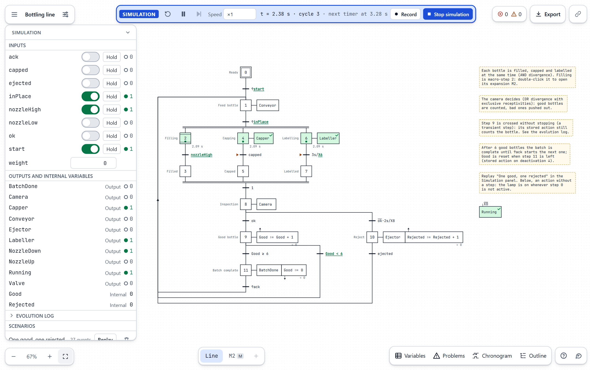
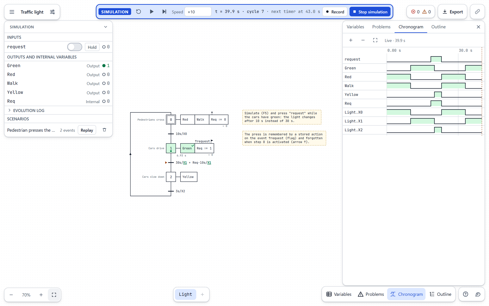
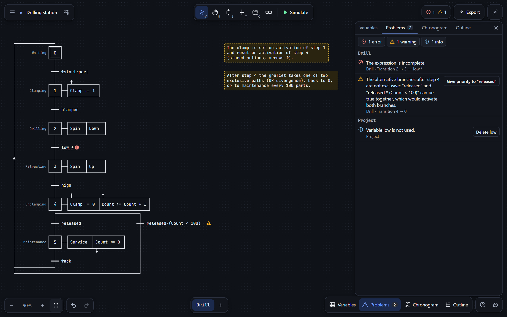
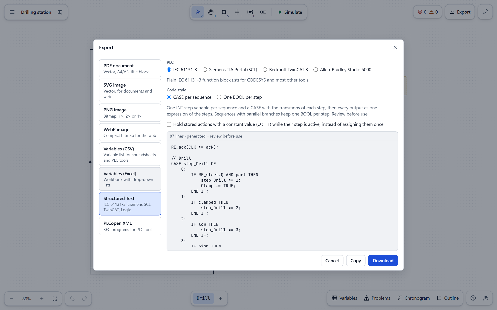
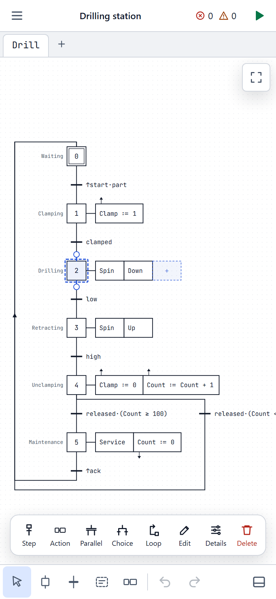
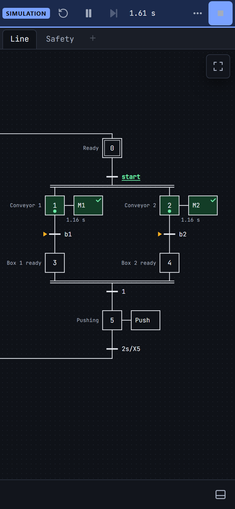

<div align="center">


# GrafcetMaker

**Draw, check and simulate GRAFCET charts (IEC 60848) in your browser, then turn them into PLC
code.**

[](https://grafcet.org)

[](https://github.com/AronLenvig/GrafcetMaker/actions/workflows/ci.yml)
[](LICENSE)
[](https://grafcet.org/en/)
[](#self-hosting)

[GRAFCET guide](https://grafcet.org/en/) · [Help center](https://grafcet.org/help/) ·
[Self-hosting](#self-hosting) · [Contributing](CONTRIBUTING.md)

<br />

<picture>
  <source media="(prefers-color-scheme: dark)" srcset="docs/images/hero-dark.png" />
  
</picture>

</div>

<br />

GrafcetMaker is a GRAFCET editor and simulator for automation engineers, teachers and students. It
follows the evolution rules of IEC 60848 to the letter, checks your chart while you draw, and
generates Structured Text and PLCopen XML for your PLC.

- **Free and open source** (MIT). No paid tier, no limits on projects, grafcets or steps.
- **Nothing to install, no account.** It runs in any modern browser, and can be installed as an app.
- **Your projects stay yours.** They are stored on your computer, live sessions are end-to-end
  encrypted, there is no tracking, and it works offline and air-gapped.

## Simulate exactly as the standard says



Press <kbd>F5</kbd> and the chart comes alive. Tokens mark the active steps, enabled transitions
and true signals light up, and step timers count. Behind it is a faithful implementation of
IEC 60848: simultaneous clearing, search for stability with unstable (transient) steps, rising and
falling edges, timers, and forcing orders between grafcets.

- Click inputs in the panel or right on the diagram; hold a button for a momentary press.
- Virtual time: real time, ×N fast forward that jumps to the next timer, or one evolution at a time.
- A **chronogram** of every variable with time travel, an evolution log per cycle, and recorded
  scenarios you can replay.

## Errors caught while you draw



Every receptivity and action is parsed as you type, with the exact error position and a
“did you mean” for unknown names. The checks go further than syntax: unreachable steps, dead ends,
alternative branches that are not exclusive, possible transient loops, outputs driven from parallel
branches, and macro-step or forcing inconsistencies. Most problems come with a quick fix.

## From chart to PLC code



| Target                    | What you get                                                              |
| ------------------------- | ------------------------------------------------------------------------- |
| IEC 61131-3               | a function block (`.st`) for CODESYS and most other tools                 |
| Siemens TIA Portal        | an SCL source for S7-1200/1500, ready for **Generate blocks from source** |
| Beckhoff TwinCAT 3        | a POU file (`.TcPOU`) to add to the PLC project                           |
| Allen-Bradley Studio 5000 | a Structured Text routine with its tag list                               |
| PLCopen XML (TC6)         | one SFC program per grafcet, for engineering tools with PLCopen import    |

Structured Text comes as a `CASE` per sequence, the way you would write it by hand, or as one BOOL
per step with an optional search for stability. For documents: vector PDF on A4 or A3 with a title
block and tiling, SVG, PNG and WebP, copy to the clipboard, and the variable table to Excel and CSV.
Generated code is a starting point: always review it before it runs on a machine.

## Fast to draw, on any screen

The keyboard does most of the work: <kbd>Enter</kbd> appends a transition and a step and puts you
in the receptivity, <kbd>A</kbd> adds an action, <kbd>P</kbd> and <kbd>O</kbd> open parallel and
alternative branches, <kbd>L</kbd> loops back, and <kbd>Del</kbd> heals the sequence. Links only
snap to valid targets, auto-layout tidies on demand, and <kbd>Ctrl</kbd>+<kbd>K</kbd> finds any
command. Phones get their own one-handed layout, and touch screens get gestures and a selection
toolbar.

<p align="center">
  
  &nbsp;&nbsp;
  
</p>

## Try it

- **Online:** open [grafcet.org](https://grafcet.org). The start screen has six examples, from a
  traffic light to a bottling line with a macro-step, and a ten-step tour.
- **As an app:** install it from the browser; it then starts like a desktop program and works
  offline.
- **On your own server:** `docker build -t grafcetmaker . && docker run -p 8080:8080 grafcetmaker`,
  or copy the static build anywhere (see [Self-hosting](#self-hosting)).
- **New to GRAFCET?** The [GRAFCET guide](https://grafcet.org/en/) explains the standard with
  diagrams, in English, [French](https://grafcet.org/fr/), [German](https://grafcet.org/de/) and
  [Spanish](https://grafcet.org/es/).

## Features

- **Fast editing**: keyboard-first drawing (`Enter` continues a sequence, `A` adds an action, `P` /
  `O` add parallel or alternative branches, `L` loops back), link handles that only accept valid
  targets, delete that heals the sequence, copy/paste across projects, undo/redo, on-demand
  auto-layout, contextual hints, command palette, split view of two grafcets.
- **Full GRAFCET**: steps, transitions, OR/AND divergences and convergences, source/sink
  transitions, continuous, conditional and stored actions (activation ↑, deactivation ↓, event),
  timers, edges, comparisons, several partial grafcets, macro-steps, enclosing steps, forcing.
- **Checks while you draw**: syntax and types of every expression, unknown variables with
  one-click creation, reachability, dead ends, non-exclusive alternatives, possible transient loops,
  outputs driven from parallel branches, hierarchy and forcing consistency.
- **Live collaboration**: edit a project together in real time from a link, with everyone's
  pointer, selection and name on the diagram, changes merged field by field, undo of your own
  changes only, offline edits merged on reconnect, and end-to-end encryption (the key is only in
  the link).
- **Simulation** by the IEC 60848 rules (search for stability, simultaneous clearing, edges, timers,
  forcing) with virtual time, tokens on the diagram, evolution log, chronogram with time travel and
  recorded scenarios.
- **Exports**: vector PDF (A4/A3, title block, tiling), SVG, PNG, WebP, clipboard; variables to
  Excel and CSV (and back); **Structured Text** (a CASE per sequence, as written by hand, or one
  BOOL per step) for IEC 61131-3, Siemens TIA Portal (SCL), Beckhoff TwinCAT 3 and Allen-Bradley
  Studio 5000, and **PLCopen XML** (SFC) generation.
- **Learn as you go**: start screen with examples, guided tour, help center with a beginner
  tutorial and diagrams, glossary of standard terms, in-app changelog, and a GRAFCET guide web
  page in English, French, German, Spanish, Danish and Swedish.
- **Phones and tablets**: a one-handed phone layout (bottom toolbar, panels in a sheet, menu
  drawer), pinch-zoom, double-tap, and a selection toolbar for what the shortcuts do.
- **Accessible and offline**: WCAG 2.2 AA (keyboard everywhere, outline tree view, light/dark
  contrast), installable PWA that works without a network.
- Projects are human-readable `.grafcet.json` files (versioned, validated on load), autosaved in
  the browser with crash recovery and local history. Files from grafcet.io (`.grafcetio`) open
  too, converted into a project.

See [`docs/user-guide.md`](docs/user-guide.md) for the complete reference, the in-app help
([`docs/help/`](docs/help/index.md)) for guides, and [`PROGRESS.md`](PROGRESS.md) for the build log.

## Self-hosting

GrafcetMaker is a static site. The build uses relative paths, so it works under any sub-path
(`https://intranet.example.com/tools/grafcet/`).

### Static files

```sh
npm ci
npm run build
# copy dist/ to any web server
```

Serve `index.html`, `sw.js` and `manifest.webmanifest` with `Cache-Control: no-cache`; files in
`assets/` are fingerprinted and can be cached forever. See [`deploy/nginx.conf`](deploy/nginx.conf).

### Configuration

**Help › Send feedback** picks the first channel this installation offers:

1. **Anonymous endpoint** (the public site): the message is posted to `api/feedback` on the same
   origin and filed as an issue in a private GitHub repository. Senders need no account and may
   leave a contact for a reply; no email address appears in the app.
2. **Email**: with `VITE_FEEDBACK_EMAIL=plc-team@example.com npm run build`, the user's email app
   opens with the message to that address.
3. **Copy** only, when neither is set up (the default for on-premise installs).

The endpoint and its setup are described under [Cloudflare Workers](#cloudflare-workers-public-site).

### Cloudflare Workers (public site)

[`wrangler.jsonc`](wrangler.jsonc) deploys `dist/` as static assets plus a small Worker,
[`worker/index.ts`](worker/index.ts), that serves the feedback endpoint at `/api/feedback`
([`worker/feedback.ts`](worker/feedback.ts)); every other request is answered from the static
files. Connect the repository in **Workers & Pages** (Workers Builds: build command
`npm run build`, deploy command `npx wrangler deploy`), or deploy by hand with
`npm run build && npx wrangler deploy`. Rename `name` in `wrangler.jsonc` to match your Worker.

To enable the feedback endpoint:

1. Create a **private** GitHub repository for feedback, e.g. `grafcetmaker-feedback`.
2. Create a fine-grained personal access token limited to that repository with
   **Issues: Read and write** (and nothing else).
3. Set `GITHUB_REPO` (`owner/name`) under `vars` in `wrangler.jsonc`, and add the token as the
   secret `GITHUB_TOKEN` in the Worker › Settings › Variables and Secrets (or
   `npx wrangler secret put GITHUB_TOKEN`). Secrets survive deploys; plain variables set only in
   the dashboard do not.
4. Recommended: a Cloudflare rate-limiting rule on `/api/` (e.g. 20 requests per minute per IP)
   against feedback spam and scripts opening many live rooms; the Worker itself keeps no record
   of who sends what.

Live collaboration needs nothing to set up: the same Worker relays live sessions at
`/api/room/<id>` with one Durable Object per room ([`worker/collab.ts`](worker/collab.ts), SQLite
storage, available on the Workers Free plan). The migration in `wrangler.jsonc` creates it on the
first deploy. Messages are end-to-end encrypted in the browser, so the Worker forwards and stores
data it cannot read; a room's storage is deleted 30 days after its last change.

The Worker also serves the root page (`/`, in `run_worker_first`) with the visitor's country from
Cloudflare on `<html data-country>` ([`worker/country.ts`](worker/country.ts)): the app starts a
first visit in French, German or Spanish for those countries and in English otherwise. Nothing is
stored or logged. Without the Worker (on premises, other hosts) a first visit starts in English.

Security headers (no framing by other sites, `nosniff`, no referrer, HTTPS only…) come from
[`public/_headers`](public/_headers) for the static files and from
[`worker/headers.ts`](worker/headers.ts) for the Worker's own responses; keep the two in step with
[`deploy/security-headers.conf`](deploy/security-headers.conf), which nginx uses. The live relay
accepts WebSockets only from the site's own pages (and from `localhost` for development).

New feedback then arrives as GitHub notifications (web, mobile app or the email of your GitHub
account, which stays private). Renew the token before it expires. Without these settings the
endpoint answers `{ "ok": false }` and the app falls back to email or copy.

### Website pages and search engines

Besides the app, the build writes the public website's pages for search engines and visitors:

- `en/`, `fr/`, `de/`, `es/`: the editor in that language: `index.html` with the language's
  title, description and home page text ([`docs/home/<lang>.md`](docs/home/en.md)) for readers
  without JavaScript, such as AI crawlers (the editor replaces it). The root `index.html` (English
  text) starts in the visitor's saved language, else in the language of their country (English
  elsewhere);
- `<lang>/guide/`: the GRAFCET guide, static HTML rendered at build time from
  [`docs/guide/<lang>.md`](docs/guide/en.md) by [`src/site/`](src/site/render.ts), with diagrams
  drawn by the editor's own exporter and examples that open in the editor;
- `<lang>/help/`: the in-app help pages ([`docs/help/`](docs/help/index.md)) as static HTML
  (`_redirects` sends the former `help/` addresses to `en/help/` on Cloudflare);
- `sitemap.xml` (every page with its language versions), `robots.txt` and `llms.txt`;
- in every editor page: a canonical link, hreflang alternates, Open Graph preview
  (`og-image.png`) and structured data.

Absolute URLs use `SITE_URL` (default `https://grafcet.org/`). A public mirror builds with its own
address, `SITE_URL=https://grafcet.example.com/ npm run build`; on-premise installs need nothing.

After deploying the public site, add it to [Google Search Console](https://search.google.com/search-console)
and [Bing Webmaster Tools](https://www.bing.com/webmasters), submit `sitemap.xml` and request
indexing of the editor and guide pages.

### Docker

```sh
docker build -t grafcetmaker .
docker run --rm -p 8080:8080 grafcetmaker
# open http://localhost:8080
```

The image is an unprivileged nginx serving the static build on port 8080 with security headers.

### Live collaboration on premises

Live sessions need a small relay next to the app, on the same origin at `<app path>/api/room`:
[`server/relay.ts`](server/relay.ts) (Node 22.18 or later, package `ws`). It forwards encrypted
messages and keeps each room's encrypted snapshot (in memory, or in `RELAY_DATA_DIR`). With
Docker:

```sh
docker compose -f deploy/docker-compose.yml up -d --build
# open http://localhost:8080
```

This runs the app and the relay ([`deploy/relay.Dockerfile`](deploy/relay.Dockerfile)); nginx
forwards `api/room` to it with [`deploy/relay-proxy.conf`](deploy/relay-proxy.conf). Behind another
web server, proxy `…/api/room` and `…/api/room/<id>` (with WebSocket upgrade) to the relay's port
(`PORT`, default 8081). Without a relay the app works as before and shows the share link instead.

## Development

```sh
npm ci
npm run dev       # dev server
npm run check     # typecheck + lint + unit tests + build
npm run e2e       # Playwright smoke and live collaboration tests (Chromium)
npm run relay     # live collaboration relay on port 8081
```

To try live sessions locally, run `npm run relay` and start the dev server with
`GM_RELAY_URL=http://localhost:8081 npm run dev` (it proxies `api/room` to the relay); or run the
Worker itself with `npm run build && npx wrangler dev`.

Architecture overview:

```
src/core/{model,expr,validation,simulation,layout,codegen,io,collab}  pure TypeScript
src/editor/{canvas,tools,commands}                              SVG editor
src/panels  src/theme  src/i18n  src/workers  src/app           UI shell
src/site                                                        website guide pages (build time)
worker/  server/relay.ts           Cloudflare Worker (feedback, live relay), on-premise relay
docs/{user-guide,semantics,file-format}.md   docs/help/*.md (in-app help pages)
docs/guide/<lang>.md (website GRAFCET guide)
```

To edit the guide, change `docs/guide/<lang>.md` (the same Markdown subset as the help pages;
`<!-- figure: id | caption -->` draws a diagram of `src/site/figures.ts`, `example-<id>` one of the
start screen examples, and `app:` links lead into the editor), keep the six languages in step, and
update `updated` in `src/site/locales.ts`. Preview with `npm run build && npm run preview`.

See [`CONTRIBUTING.md`](CONTRIBUTING.md) for conventions and
[`docs/semantics.md`](docs/semantics.md) for the exact IEC 60848 interpretation used.

## License

[MIT](LICENSE). Bundled third-party assets keep their own licences: see
[THIRD_PARTY_NOTICES.md](THIRD_PARTY_NOTICES.md).
